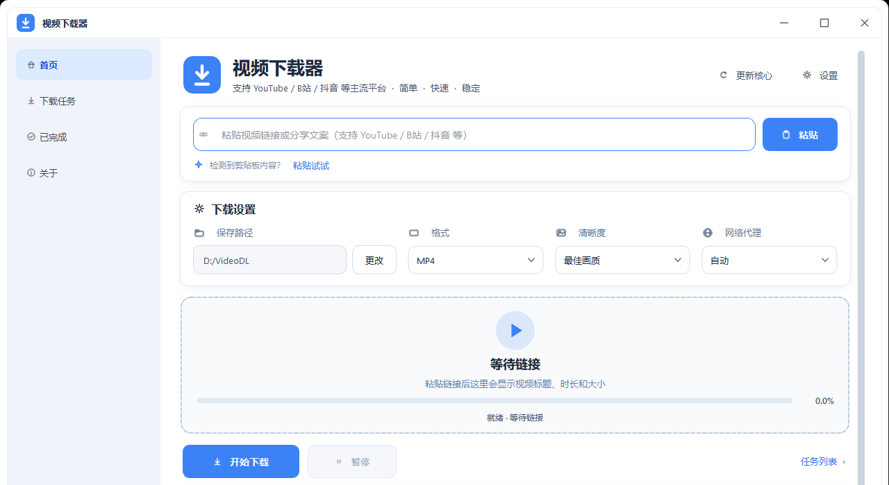

# VideoDL — 视频下载器

基于 [yt-dlp](https://github.com/yt-dlp/yt-dlp) 的视频下载工具，一个仓库里装三种形态：

| 形态 | 入口 | 技术栈 | 状态 |
|---|---|---|---|
| **安卓 App** | `VideoDL-Android/` | Kotlin + Jetpack Compose + Chaquopy（内嵌 yt-dlp 与 ffmpeg） | v1 已完成，真机验证过 |
| **桌面 Fluent 版** | `启动视频下载器.bat` → `video_downloader_qt.py` | PySide6（Windows 11 磨砂视觉） | 可用，推荐 |
| **桌面经典版** | `video_downloader.py` | Python tkinter（纯标准库） | 可用，零依赖 |

另有 `export_cookies.py`（Chrome Cookie 解密导出）和 `error_diagnosis.py`（下载失败原因诊断）两个辅助脚本。

> 两个桌面版共用同一份后端逻辑（`video_downloader.py` 既是经典版主程序，也是 Qt 版的 `core` 模块）和同一份 `config.json`，所以换版本不用重配。

### 界面预览

桌面 Fluent 版主界面（粘贴链接 → 选格式画质 → 开始下载）：



## 功能

两个桌面版都有：

- 🌐 **多平台支持** — YouTube、Bilibili、抖音 等（实际支持范围由 yt-dlp 决定）
- 🎬 **格式选择** — MP4 / WebM / MP3
- 📐 **画质选择** — 最佳 / 1080p / 720p / 仅音频
- ⚡ **优先 H.264 + AAC** — 同清晰度优先挑 h264/aac，避免下到 AV1/Opus 后在剪映、相册里打不开
- 🩹 **兼容性转码兜底** — 下完用 ffprobe 探真实编码，不是 h264+aac 就用 ffmpeg 转一遍（参数不支持会自动降级重试）
- 🔀 **代理策略** — 自动判断（YouTube 类走代理，其余直连）/ 强制代理 / 强制直连
- 🍪 **Cookie 支持** — 浏览器 Cookie 导入 / cookies.txt 文件
- 📝 **智能命名** — 自动取视频标题做文件名，重名自动加序号
- 📅 **日期归类** — 按"X月X日"自动建子文件夹
- 📊 **实时进度条 + 完整日志**
- 🔄 **核心更新** — 一键更新 yt-dlp

Fluent 版额外有：Win11 磨砂背景（Mica/Acrylic，失败自动回退不透明底）、卡片式布局、**真正的设置页**（代理 / Cookie / FFmpeg / 其他，保存前会校验）。

## 环境要求

- **Python 3.10+**（用到了 `str | None` 类型注解）
- **Windows**（GUI 依赖 Windows 视觉特性；其他平台需自行装 `python3-tk`）
- **`tools/yt-dlp.exe`** — 核心下载引擎，必需
- Fluent 版需要 **PySide6**（`启动视频下载器.bat` 会在首次运行时自动 pip 安装）

## 快速开始（桌面）

### 1. 准备 yt-dlp

```
VideoDL/
└── tools/
    ├── yt-dlp.exe      ← 必需：https://github.com/yt-dlp/yt-dlp/releases
    └── ffmpeg.exe      ← 可选：https://ffmpeg.org/download.html
```

- **ffmpeg** 用于合并音视频流、以及编码不兼容时的转码兜底。也可以不放进 `tools/`，程序会依次找：设置里指定的路径 → `tools/ffmpeg.exe` → 系统 PATH。
- 实在没有 ffmpeg 也能下载，但只能拿到单文件格式（通常清晰度较低）。

### 2. 运行

双击 **`启动视频下载器.bat`**（Fluent 版，推荐），或者：

```bash
python video_downloader_qt.py     # Fluent 版
python video_downloader.py        # 经典 tkinter 版
```

首次运行会自动生成 `config.json`。

### 3. 使用

1. 粘贴视频链接（或点「一键粘贴」读剪贴板）
2. 选格式和画质
3. 点「开始下载」
4. 完成后按配置自动打开文件夹

## 安卓版

原生 App：**minSdk 26 / targetSdk 34 / arm64-v8a**，包名 `com.videodl.app`。

### 功能

- **底部导航三标签**：首页 / 下载 / 更多
- **首页**：大标题 → 胶囊输入框（左粘贴、右抓取）→ 结果卡（缩略图铺满 + 渐变压暗 + 右下圆形按钮）→ 格式/日志 chip → 当前下载状态卡
- **格式选择底部弹窗**：按清晰度分组，**同清晰度 H.264 排第一**；HEVC/AV1 行标注「剪映/相册可能不支持此编码」；显示编码·分辨率·容器·format_id·体积·码率。选到纯视频流会**自动配上音频**
- **下载页**：进行中卡片（进度、速度、取消）+ 队列分组（可单条移除）+ 历史卡片 + 筛选 chip（全部/视频/音频）
- **前台 Service + 通知栏**：切走 App / 锁屏继续下载；通知显示进度·速度·剩余·队列数，带取消按钮
- **默认存进系统相册**：发布到 `Movies/VideoDL`，可直接在相册或剪映里打开（不需要 `MANAGE_EXTERNAL_STORAGE`）
- **分享直达**：从其他 App 分享链接过来会**直接开始下载**，不依赖主界面是否活着
- **下载队列**：一次跑一个，其余排队，上限 5 个；「停止」清空队列
- **编码兜底（⚠️ 当前在安卓上不生效，见下）**：下载后用 ffprobe 探真实编码，不是 h264+aac 就走 ffmpeg 转码，分辨率限制在 1080P 以内
- **仅音频存成 m4a**（不是 mp3）：m4a 在源音轨是 AAC 时靠重新封装（`copy`）产出，**不需要编码器**；
  mp3 需要 `libmp3lame`，而打包的 ffmpeg 里没有（见下）。产物进 `Music/VideoDL`
- **代理**：VPN 优先直连；`auto` 模式下地址可达才走代理（`127.0.0.1` 视为合法地址，适配 Clash / v2rayNG 本机端口），连不上就回退直连并在日志说明
- **下载记录**：`filesDir/downloads.json`，损坏时降级为空；记录标题/uri/缩略图/格式/体积/状态/时间/时长/作者

v1 明确不做：播放列表、定时下载、多选、浏览器 Cookie 导入、字幕、终端页。

### ⚠️ 已知问题：安卓端的「编码兜底」转码跑不通

**真机已确认**（PJC110 / Android 15）：打包的 `libffmpeg.so` 里**只有一个编码器 `mjpeg`**：

```
$ adb shell run-as com.videodl.app <nativeLibraryDir>/libffmpeg.so -encoders
Encoders:
 ------
 VFS..D mjpeg
```

它是按 `--disable-gpl --disable-nonfree --enable-version3 --disable-everything`
构建的 **LGPL-3.0** 精简包。所以**没有 H.264 编码器，也没有 aac 编码器**，
`ytdlp_bridge.py` 里请求的 `-c:v libx264` / `-c:a aac` 必然失败。

现在的行为（已改成不再白跑两次、也不再打误导日志）：转码前先探测编码器能力，
发现没有 H.264 编码器就立刻如实说明并保留原文件，提示用户改选 H.264 的清晰度。

实际后果：格式选择仍然会优先挑 H.264（这条是好的、有效的），
但**当某一清晰度只提供 HEVC/AV1 时，App 无法把它转成 H.264**。
合并音视频流不受影响（那是 `-c copy`，不需要编码器）。

原因和修法是绑在一起的：**libx264 是 GPL**，所以任何「能商用」的 ffmpeg 构建里都不会有它。
要让转码真的可用，需要重建 `libffmpeg.so`，二选一：

- 加 `--enable-libopenh264`（BSD 许可）做软件 H.264 编码，或
- 加 `--enable-jni --enable-mediacodec --enable-encoder=h264_mediacodec`（Apache-2.0，
  **用手机硬件编码，比 x264 快得多**），另加原生 `aac` 编码器

### 构建与安装

```bash
cd VideoDL-Android

# 单测 + 装 debug 包
./gradlew.bat :app:testDebugUnitTest :app:assembleDebug --console=plain

adb install -r app/build/outputs/apk/debug/app-debug.apk
```

构建需要联网（Chaquopy 构建期会 `pip install yt-dlp`），并且需要能写 `~/.gradle`。

### release 签名包

`assembleRelease` 在**没有密钥库时不会报错**，会产出 `app-release-unsigned.apk`（未签名，装不上），并在构建日志里用英文提示一行。要出可安装的签名包，一次性生成密钥：

```bash
keytool -genkey -v -storetype PKCS12 -keystore videodl-release.keystore \
  -alias videodl -keyalg RSA -keysize 2048 -validity 10000
```

然后在 `VideoDL-Android/local.properties` 里补上（该文件已被 `.gitignore` 排除）：

```properties
KEYSTORE_FILE=videodl-release.keystore
KEYSTORE_PASSWORD=你的密码
KEY_ALIAS=videodl
KEY_PASSWORD=你的密码
```

也可以 `-PKEYSTORE_FILE=... -PKEYSTORE_PASSWORD=... -PKEY_ALIAS=... -PKEY_PASSWORD=...` 临时传。

> ⚠️ **密钥库和密码丢了，就无法再给已安装的用户升级**（只能卸载重装）。`.gitignore` 已排除 `*.jks` / `*.keystore`，别手动提交。
>
> ⚠️ release 包与 debug 包**签名不同，不能互相覆盖安装** —— 从 debug 换到 release 需要先卸载，App 内的下载记录/设置会被清掉（已发布到相册的视频不受影响）。
>
> ⚠️ release 目前**故意没开混淆**（`isMinifyEnabled = false`）：`proguard-rules.pro` 还是空的，而 Chaquopy 靠反射调 Python 桥，开着混淆又没写 keep 规则会导致"装得上但一跑就崩"。等有真机验证过 release 再开。

### 真机测试小抄

```bash
# 用分享入口触发下载（最稳的自动化入口，不依赖界面点击）
adb shell am start -a android.intent.action.SEND -t text/plain \
  --es android.intent.extra.TEXT "<url>" -n com.videodl.app/.ShareReceiver

# 把 App 拉回前台（CLEAR_TOP，可清掉顶上的播放器）
adb shell "am start -n com.videodl.app/.MainActivity -f 0x04000000"

# 看应用日志（队列状态等关键节点已写 logcat）
adb logcat -d -s VideoDL:V python.stdout:V python.stderr:V
```

## 配置说明（桌面 `config.json`）

程序自动管理，字段如下（另见 `config.example.json`）：

| 字段 | 类型 | 说明 |
|------|------|------|
| `save_dir` | string | 视频保存根目录 |
| `proxy_mode` | string | `"auto"` 自动 / `"direct"` 直连 / `"proxy"` 强制代理 |
| `proxy_url` | string | 代理地址，默认 `http://127.0.0.1:7897` |
| `cookie_mode` | string | `"none"` / `"file"` / `"browser"` |
| `cookie_path` | string | cookies.txt 路径 |
| `cookie_browser` | string | chrome / firefox / edge / opera / brave / safari |
| `default_format` | string | `"mp4"` / `"webm"` / `"mp3"` |
| `default_quality` | string | `"best"` / `"1080p"` / `"720p"` / `"audio"` |
| `auto_open_folder` | bool | 下载完是否自动打开文件夹 |
| `ffmpeg_path` | string | 手动指定的 ffmpeg 路径；留空则自动查找 |

Fluent 版的「设置」页可以直接改前 6 项加 `auto_open_folder` / `ffmpeg_path`，不用手编 JSON。

## 项目结构

```
VideoDL/
├── video_downloader.py        # 经典 tkinter 版主程序 + 共用后端逻辑（Qt 版的 core）
├── video_downloader_qt.py     # Fluent 版界面（PySide6）
├── 启动视频下载器.bat          # 启动 Fluent 版（会自动装 PySide6）
├── export_cookies.py          # Chrome Cookie 解密导出
├── error_diagnosis.py         # 下载失败诊断
├── config.example.json        # 示例配置
├── requirements.txt
├── LICENSE                    # MIT
├── docs/
│   ├── specs/                 # 安卓版设计文档
│   └── superpowers/plans/     # 安卓版实施计划
├── tools/                     # 外部可执行文件（自行下载，不入库）
│   ├── yt-dlp.exe
│   └── ffmpeg.exe
└── VideoDL-Android/           # 安卓工程
    └── app/src/main/
        ├── java/com/videodl/app/   # Kotlin（engine / service / data / ui）
        ├── python/ytdlp_bridge.py  # Chaquopy 桥脚本
        ├── assets/                 # 桥脚本入口
        └── jniLibs/                # libffmpeg.so / libffprobe.so（arm64-v8a）
```

## 常见问题

**Q: 启动报错「未找到 yt-dlp.exe」**
A: 从 [yt-dlp Releases](https://github.com/yt-dlp/yt-dlp/releases) 下载 `yt-dlp.exe` 放进 `tools/`。

**Q: 下载的视频没有声音 / 画音不同步**
A: 需要 ffmpeg 合并音视频流。放进 `tools/`，或装到系统 PATH，或在设置页里指定路径。

**Q: YouTube 下载失败**
A: 多半是网络。把代理模式设成 `proxy` 并填对地址（Clash 默认 7890/7897，v2rayNG 常用 10809）。安卓版在 `auto` 模式下会先探测地址是否可达。

**Q: 需要登录才能看的视频**
A: Cookie 模式切到 `browser` 选浏览器（先在浏览器里登录），或用 `file` 模式导入 cookies.txt。Chrome 的加密 Cookie 可以用 `export_cookies.py` 导出。

**Q: 下下来的视频剪映打不开 / 相册不认**
A: 第一步是**在格式弹窗里手动挑标着 H.264 的那一行**，这是目前唯一可靠的办法。
「优先 H.264 + AAC」这个排序是有效的；但**安卓端的自动转码兜底目前不生效**
（打包的 ffmpeg 没有 h264/aac 编码器，见上面「已知问题」）。桌面端用的是系统
ffmpeg，转码是正常的。

**Q: B 站下载 SSL 失败**
A: 已知在某些网络环境（含本机）会对 B 站 CDN 报 SSL 错误，绕过本工具直接用 yt-dlp 也一样，属于环境问题。

## 测试

```bash
# 安卓 JVM 单测
cd VideoDL-Android && ./gradlew.bat :app:testDebugUnitTest

# 安卓仪器测试（需要真机/模拟器）
./gradlew.bat :app:connectedDebugAndroidTest
```

`androidTest` 下的 `ShareReceiverTest`、`ConfigRepositoryTest` 需要连真机才能跑。

## 注意事项

- 本项目仅供学习和个人使用，请遵守相关平台的服务条款和当地法律法规。
- 请尊重版权，不要下载未经授权的内容。
- yt-dlp 与 ffmpeg 是各自所有者的项目，与本项目无关。

## 许可证

MIT License — 详见 [LICENSE](LICENSE)。
